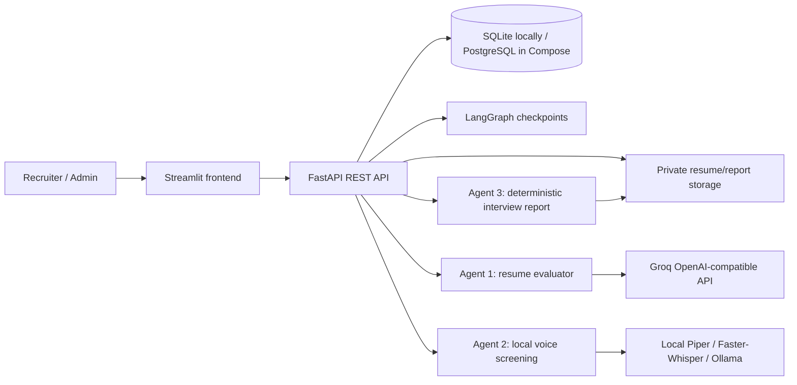
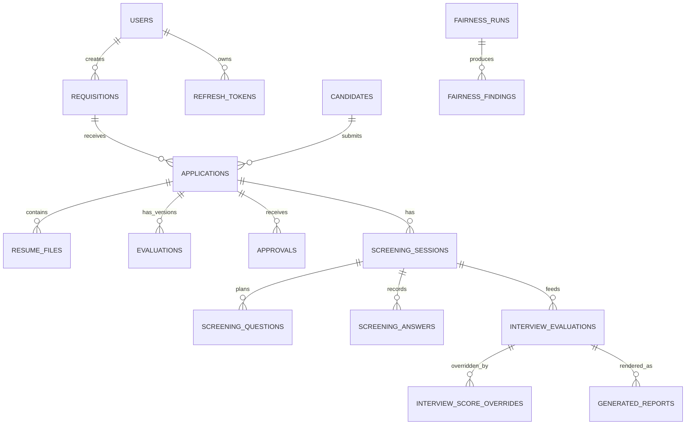

# Trustworthy HR Hiring Platform — Technical Document

> **Evidence basis.** This document describes the checked-in project as inspected on 2026-11-23. Every implementation claim cites a project file. Private environment files and credential-bearing files were deliberately not opened; setting names are mentioned without values. “Not found in the project” means the inspected files did not provide evidence.

## 1. Project overview

This is a human-supervised hiring decision-support application. It accepts job requisitions and resume files, produces evidence-linked resume scores, supports a consent-based local voice screening flow, and has a partially implemented interview-report stage. It explicitly describes itself as not making autonomous hiring decisions or real-world invitations. [backend/app/main.py (`FastAPI` description); README.md]

The visible user roles are `recruiter`, `interviewer`, and `admin`. Recruiters receive permissions to manage requisitions, upload/evaluate resumes, review candidates, and make progression decisions; interviewers only receive candidate-view permission; administrators manage users, audit access, deletion, and fairness views. [backend/app/core/permissions.py (`Role`, `Permission`, `_ROLE_PERMISSIONS`)]

In plain language, the intended implemented path is:

1. An administrator creates user accounts, while a recruiter signs in. [backend/app/api/auth.py (`create_user`, `login`)]
2. A recruiter creates a requisition with skills, job description, screening questions, and a weighted rubric. [backend/app/api/requisitions.py (`create_requisition`); backend/app/schemas/requisition.py]
3. The recruiter uploads PDF/DOCX resumes. The backend validates/parses each file and creates a candidate/application record when accepted. [backend/app/api/resume_upload.py (`upload_resumes`); backend/app/services/resume_parser.py (`parse_resume`)]
4. Agent 1 evaluates an extracted resume against a requisition rubric. It redacts personal information, excludes suspected instructions, asks the configured Groq provider for a structured evidence response, verifies evidence references, then calculates the weighted score in Python. [backend/app/agents/resume_agent.py; backend/app/services/redaction.py; backend/app/services/injection_guard.py; backend/app/services/scoring.py]
5. A recruiter reviews the result and records a shortlist decision. Only approval can move an application into the screening handoff. [backend/app/services/evaluation_service.py (`decide`); backend/app/core/status.py (`ALLOWED_TRANSITIONS`)]
6. Agent 2 is a **local voice-screening flow**, not a telephony integration: the candidate gives consent, questions are spoken locally, discrete audio answers are transcribed locally, and confirmed answers form a screening report for HR review. [backend/app/services/screening_service.py; backend/app/integrations/local_voice.py; backend/app/api/screenings.py]
7. Agent 3 is **partial**: it deterministically derives interview evidence/levels from confirmed screening statements and can generate labelled PDF/DOCX/JSON reports. A recruiter can override a scored criterion with a reason and record a final decision. [backend/app/services/interview_scoring_service.py; backend/app/services/report_service.py; backend/app/api/interviews.py]

## 2. Architecture

The system is a FastAPI REST backend with a Streamlit frontend. The frontend only calls the REST API through `requests` and holds its bearer token in Streamlit session state. [frontend/api_client.py (`APIClient`, `client`); frontend/app.py]

The backend composes routers for authentication, requisitions, private uploads, applications/history, candidates, evaluations, screenings, interview reports, fairness, and final recommendations. It uses SQLAlchemy sessions against SQLite by default or PostgreSQL when configured. [backend/app/main.py; backend/app/database/connection.py (`make_engine`, `SessionLocal`)]

The resume evaluation workflow uses LangGraph and persistent SQLite or PostgreSQL checkpointers. It stops at an `interrupt` for the authorized recruiter decision, then resumes with `Command`. The screening workflow similarly uses persisted interrupt gates for candidate commands and HR review. [backend/app/workflows/hiring_graph.py (`build_hiring_graph`, `persistent_checkpointer`); backend/app/workflows/screening_graph.py (`build_screening_graph`, `sync_screening_checkpoint`)]



The application status state machine includes `Resume Received`, `Needs Manual Review`, `Scored — HR Review`, `Approved for Screening`, `Screening Scheduled / Pending`, `Screening Completed — HR Review`, `Interview Scored - HR Review`, `On Hold`, `Approved for Interview`, `Interview Proposed`, `Interview Scheduled`, and `Closed`. The transition table is implemented in code rather than as a database enum. [backend/app/core/status.py (`Status`, `ALLOWED_TRANSITIONS`)]

## 3. Technology stack

The table covers direct project dependencies and project tools found in dependency files, source, or container definitions. Exact locked versions are taken from `requirements.lock.txt` when present; `>=`/`<` ranges are not exact pins. [backend/requirements.txt; frontend/requirements.txt; backend/requirements-voice.txt; requirements.lock.txt; pyproject.toml]

| Technology | Version | Purpose in this project | Where it is used |
| --- | --- | --- | --- |
| Python | Project range `>=3.11,<3.13`; local documentation says Python 3.11.17 | Backend, Streamlit UI, migrations, scripts, tests | pyproject.toml; README.md |
| FastAPI | `>=0.115`, lock: `0.162.2` | REST API, dependency injection, response validation, OpenAPI docs | backend/app/main.py; backend/app/api/*.py; requirements.lock.txt |
| Uvicorn | `>=0.30`, lock: `0.54.0` | ASGI server in local and Docker start commands | backend/requirements.txt; backend/Dockerfile |
| Streamlit | `>=1.44,<2`, lock: `1.67.0` | Human-facing dashboard, recruiter workflow, candidate voice route | frontend/app.py; frontend/pages/*.py; requirements.lock.txt |
| SQLAlchemy | `>=2.0`, lock: `2.1.8` | Typed ORM models, sessions, constraints and queries | backend/app/database/*.py; backend/app/services/*.py |
| Alembic | `>=1.13`, lock: `1.20.1` | Schema versioning and upgrades | backend/alembic/; backend/alembic.ini |
| SQLite | No separately pinned Python package; built-in database selected by default | Local/default relational database and local LangGraph checkpoint storage | backend/app/core/config.py (`database_url`); backend/app/database/connection.py |
| PostgreSQL | Compose image `postgres:16-alpine`; `psycopg[binary]>=3.2`, lock `3.3.8` | Configurable production-style database and optional checkpoint store | docker-compose.yml; backend/app/database/connection.py; backend/app/workflows/hiring_graph.py |
| Pydantic v2 / pydantic-settings | Pydantic `>=2.7`, lock `2.14.3`; settings pinned `2.16.3` | Request/response models, rubric/LLM validation, typed settings | backend/app/schemas/*.py; backend/app/core/config.py |
| OpenAI Python SDK | `>=2,<3`, lock `2.54.0` | OpenAI-compatible Groq client and optional Azure structured-output client | backend/app/integrations/groq_cloud.py; backend/app/integrations/azure_provider.py |
| GroqCloud | Provider/service, not a package version; model default `openai/gpt-oss-120b` | Agent 1 structured resume evidence evaluation | backend/app/core/config.py (`GROQ_BASE_URL`, `groq_model`); backend/app/integrations/groq_cloud.py |
| Azure OpenAI | Optional provider; deployment default `gpt-4.1-mini`; API version default `2024-10-21` | Implemented structured-output adapter; configuration is optional/dormant in the main Agent 1 path | backend/app/core/config.py; backend/app/integrations/azure_provider.py |
| LangGraph | `>=1.0,<2`, lock `1.2.20` | Persisted state graphs and human-interrupt checkpoints | backend/app/workflows/hiring_graph.py; backend/app/workflows/screening_graph.py |
| langgraph checkpoint SQLite/Postgres | SQLite `>=3.0.1,<5`, lock `3.1.3`; Postgres `>=3.0,<5`, lock `3.2.0` | Restart-resilient checkpoint persistence | backend/app/workflows/hiring_graph.py (`persistent_checkpointer`) |
| PyJWT | `>=2.8`, lock `2.15.1` | JWT access and session-scoped candidate tokens | backend/app/core/security.py; backend/app/api/auth.py; backend/app/api/screenings.py |
| argon2-cffi | `>=23.1,<26`, lock `25.1.0` | Argon2id password hashes | backend/app/core/security.py |
| python-multipart | `>=0.0.9`, lock `0.0.33` | FastAPI form/file upload handling | backend/app/api/resume_upload.py; backend/app/api/screenings.py |
| pypdf / cryptography | pypdf `>=4.2`, lock `7.0.0`; cryptography `>=42`, lock `50.0.2` | PDF parsing and encrypted-PDF handling | backend/app/services/resume_parser.py; scripts/generate_synthetic_resumes.py |
| PyMuPDF | `>=1.26,<2`, lock `1.28.2` | PDF text extraction/parsing | backend/app/services/resume_parser.py |
| python-docx | `>=1.1`, lock `1.2.0` | DOCX parsing, synthetic DOCX generation, Agent 3 DOCX reports | backend/app/services/resume_parser.py; backend/app/services/report_service.py |
| ReportLab | `>=4.0`, lock `5.1.0` | Synthetic PDFs and Agent 3 PDF reports | scripts/generate_synthetic_resumes.py; backend/app/services/report_service.py |
| Pillow | `>=10.0`, lock `13.0.0` | Creates an image-only PDF fixture | scripts/generate_synthetic_resumes.py |
| Requests | `>=2.32,<3`, lock `2.34.2` | Streamlit-to-FastAPI REST transport | frontend/api_client.py |
| httpx | `>=0.27`, lock `0.28.1` | FastAPI testing and local voice readiness HTTP probe | backend/requirements.txt; backend/app/api/screenings.py |
| python-dotenv | `>=1.0,<2`, lock `1.2.4` | Frontend environment loading | frontend/app.py |
| pandas | `>=2.2,<3`, lock `2.3.3` | Declared frontend dependency; direct usage was not found in inspected frontend source | frontend/requirements.txt; requirements.lock.txt |
| Faster-Whisper | `>=1.1.1,<2` | Optional local speech-to-text for Agent 2 | backend/requirements-voice.txt; backend/app/integrations/local_voice.py |
| Piper TTS | `>=1.3.0,<2` | Optional local text-to-speech for Agent 2 questions | backend/requirements-voice.txt; backend/app/integrations/local_voice.py |
| Ollama / Qwen | Ollama runtime/model version documented as `0.40.16` / `qwen2.5:1.5b` for one recorded run | Optional loopback-only local bounded follow-up action selection | backend/app/integrations/local_voice.py; docs/phase3-verification.md |
| NumPy, PyAV, Hugging Face Hub, tokenizers | Ranges in backend/requirements-voice.txt; lock versions include NumPy `2.4.6` | Audio processing and local voice-model support dependencies | backend/requirements-voice.txt |
| pytest | `>=8.0`, lock `9.2.0` | Automated backend/frontend tests | tests/; pytest.ini; requirements.lock.txt |
| Ruff | `>=0.12,<1`, lock `0.17.4` | Linting using selected E/F error classes | pyproject.toml; backend/requirements.txt |
| Docker / Compose | Dockerfile base `python:3.12-slim`; PostgreSQL image `postgres:16-alpine` | Containerized backend/frontend/database startup | backend/Dockerfile; frontend/Dockerfile; docker-compose.yml |
| PowerShell | Version not pinned | Local setup, start/stop, model setup and cleanup scripts | scripts/*.ps1; README.md |

## 4. Features

### Authentication and authorization

`POST /api/auth/login` verifies an Argon2id or legacy scrypt password, increments failed-login counts, applies exponential lockout after five failed attempts, creates a JWT access token and stores a SHA-256 hash of a random refresh token. Refresh rotates the stored refresh token; logout revokes all active refresh tokens for that user and increments its token version. [backend/app/api/auth.py (`login`, `refresh`, `logout`); backend/app/core/security.py]

Authorization is enforced by FastAPI dependencies and ownership-scoped database queries. Inaccessible requisitions/applications produce 404 from `accessible_requisition`/`accessible_application`; they are not returned merely because a Streamlit page is hidden. [backend/app/api/deps.py (`require`, `requisition_scope`, `accessible_application`)]

### Job requisitions and versioned rubrics

A recruiter creates, lists, reads and edits requisitions. Creation writes an immutable `RubricVersion` snapshot. Edits validate a merged Pydantic model, increment `rubric_version` under an optimistic update condition, save a fresh snapshot, and audit the change. [backend/app/api/requisitions.py (`create_requisition`, `edit_requisition`, `snapshot`); backend/app/database/models.py (`Requisition`, `RubricVersion`)]

The default rubric and validation rules are defined by the requisition schemas, including a weight-total rule. [backend/app/schemas/requisition.py; tests/test_status_contact_schemas.py]

### Resume upload, private storage, and parsing

The resume route accepts 1–50 files. For each file it sanitizes the filename, imposes the configured byte limit, parses PDF/DOCX content, checks declared MIME type against parsed type, detects duplicate hashes within a requisition, extracts contact details, creates candidate/application rows, and saves under a UUID file name below configured storage. Each upload uses a nested transaction so one bad file does not necessarily fail a batch. [backend/app/api/resume_upload.py (`upload_resumes`)]

The parser is responsible for PDF/DOCX type/content validation and returns parsed, rejected, or manual-review results. Tests cover scanned, encrypted, corrupt, duplicate, extension-mismatch, empty, unsupported, macro-bearing and compressed-docx cases. [backend/app/services/resume_parser.py (`parse_resume`); tests/test_resume_parser.py; tests/test_uploads.py]

### Agent 1: resume scoring

Agent 1 obtains a resume text result, applies contact redaction and injection handling, creates labelled source lines, builds an LLM prompt from the approved rubric/job text and redacted resume, requests a structured response, validates it, resolves source references to original text, and calculates scoring in application code. [backend/app/agents/resume_agent.py; backend/app/services/redaction.py; backend/app/services/injection_guard.py; backend/app/services/scoring.py]

The model response contains criterion scores/findings/explanations and source line references, while ordinary code validates criterion names, score bounds, evidence ranges and weighted score totals. The service persists an immutable evaluation version only after the workflow succeeds. [backend/app/schemas/evaluation.py (`LLMEvaluation`, `SourceReferencedEvaluation`); backend/app/services/scoring.py; backend/app/services/evaluation_service.py (`persist_evaluation`)]

This is a recommendation, not an automatic decision: a recruiter must submit the shortlist decision. Ranking exposes scores for review but does not itself progress a candidate. [backend/app/api/evaluations.py; backend/app/services/evaluation_service.py (`rankings`, `decide`)]

### Agent 2: local voice screening — **implemented but simulated/local-only**

The screening feature is explicitly local and consent-aware. A recruiter first approves a question plan. A candidate receives a short-lived session-scoped JWT, chooses consent, then can submit discrete recordings. Accepted recordings can be transcribed and corrected before they enter a report. Consent decline, human request, reschedule, stopping and unresolved questions are handled as separate states. [backend/app/api/screenings.py; backend/app/services/screening_service.py; frontend/pages/voice_screening.py; frontend/pages/screening_review.py]

Local voice runtime integration contains TTS, STT and bounded follow-up selection; it restricts the local LLM endpoint to loopback according to its tests. The implementation does not provide a real phone/SMS/email provider. [backend/app/integrations/local_voice.py; tests/test_local_voice.py; docs/phase3.md]

### Agent 3: interview scoring and reports — **partial**

The Agent 3 service reads only confirmed candidate statements from a completed screening report with accepted consent. It applies a fixed five-criterion default rubric and derives an anchor level of 2 or 3 from available statement length/topic; it does not call an LLM. It returns insufficient evidence when a criterion lacks matching statements and writes an interview evaluation plus audit event. [backend/app/services/interview_scoring_service.py (`DEFAULT_RUBRIC`, `_candidate_evidence`, `evaluate`)]

The report service renders stored evaluations deterministically to PDF, DOCX or JSON, stores the file under private configured storage, computes SHA-256, and records report generation. The download endpoint additionally audits each download. [backend/app/services/report_service.py (`get_or_create`); backend/app/api/interviews.py (`interview_report`)]

The Streamlit “Interview report” page can generate an evaluation, display quoted evidence, prepare/download reports, submit reasoned criterion overrides, and show the final decision gate. [frontend/pages/interview_report.py; frontend/app.py]

### Fairness — **partial**

The fairness service calculates selection-rate impact ratios relative to the highest sufficiently sized group and suppresses groups below five people. Its API accepts group counts supplied by the caller, persists runs/findings, and marks impact ratios below 0.8 as warnings. It does not itself create demographic groups or run counterfactual resume scoring. [backend/app/services/fairness_service.py; backend/app/api/fairness.py; backend/app/database/models.py (`FairnessRun`, `FairnessFinding`)]

### Audit, retention, observability, and dashboard

Audit events are append-only application records with a sequence number, previous hash and event hash. The audit service serializes creation through `AuditMutex`; a verification endpoint checks the chain. [backend/app/database/models.py (`AuditEvent`, `AuditMutex`); backend/app/services/audit_service.py; backend/app/services/audit_chain.py; backend/app/api/applications.py (`verify_audit_chain`)]

The retention service deletes application-related private data after an authorized deletion path while preserving audit-chain integrity; screening-specific retention runs in a lifespan background task. [backend/app/services/retention.py; backend/app/services/screening_retention.py; backend/app/main.py (`lifespan`)]

The backend adds correlation IDs, security headers, JSON log redaction, health/readiness endpoints, and in-process Prometheus text metrics. [backend/app/main.py (`security_and_correlation_headers`, `health_live`, `health_ready`, `metrics`); backend/app/core/logging.py; backend/app/core/observability.py]

## 5. Database

The local default is `sqlite:///./hr_hiring.sqlite3`; the same SQLAlchemy models can use PostgreSQL, and Compose provisions PostgreSQL 16. [backend/app/core/config.py (`Settings.database_url`); backend/app/database/connection.py; docker-compose.yml]

| Table/model | Main fields and purpose | Key relationships |
| --- | --- | --- |
| `users` / `User` | UUID, name, unique email, password hash, role, active/lockout/token-version state | Owns requisitions; referenced by uploads, decisions, reports and audit events | 
| `refresh_tokens` / `RefreshToken` | SHA-256 token hash, expiry, revocation timestamp | Many refresh tokens belong to one user; cascades on user deletion | 
| `requisitions` / `Requisition` | Job description, skills, screening questions, rubric JSON and rubric version | Created by user; has applications and rubric snapshots | 
| `rubric_versions` / `RubricVersion` | Immutable rubric and job snapshots, version, approver | Belongs to a requisition and approver | 
| `candidates` / `Candidate` | Candidate name, email, phone and timestamps | Can have applications; contact fields are plain model fields | 
| `applications` / `Application` | Candidate/requisition IDs, status, workflow/processing state, evaluation version | Unique candidate+requisition; joins candidate/requisition/resumes | 
| `resume_files` / `ResumeFile` | Original filename, storage key, SHA-256, parse outcome/warnings, extracted text | Belongs to application; unique application+file hash | 
| `evaluations` / `Evaluation` | Versioned score, rubric snapshot, criteria/evidence JSON, model/recommendation | Belongs to application/resume; only one active per application through a partial index | 
| `approvals` / `Approval` | Reviewer, approval type, decision, reason and timestamp | Belongs to application and optionally resume evaluation | 
| `screenings` / `Screening` | Legacy screening record/status/summary | Belongs to application | 
| `screening_sessions`, `screening_questions`, `screening_answers`, `screening_reports`, `screening_commands` | Durable Agent 2 consent/session/question/answer/report/idempotency state | Screen session links screening, application, candidate, requisition and evaluation | 
| `interview_evaluations`, `interview_score_overrides`, `generated_reports` | Agent 3 results, human overrides and private report metadata/hash | Evaluation links application+screening session; reports/overrides link evaluation | 
| `fairness_runs`, `fairness_findings` | Stored supplied-group fairness metrics and warnings | Findings belong to a fairness run | 
| `audit_events`, `audit_mutex` | Hash-chain event record and serialization mutex | Audit can reference application/actor/entity IDs | 
| `interviews`, `communications` | Scheduling/communication data model hooks | Present in models; no current scheduling or real email route was found | 

The initial schema is defined by migration `0001`; Phase 2 adds versioned scoring/approvals, Phase 3 adds local screening tables, Phase 4 adds lockout/refresh tokens, and revision `0005_phase4_interviews_fairness` adds interview and fairness tables. Each migration file supplies an `upgrade` and `downgrade`. [backend/alembic/versions/0001_phase1_phase_1_baseline_schema.py; backend/alembic/versions/0002_phase2_versioned_scoring_approvals_and_.py; backend/alembic/versions/0003_phase3_local_screening.py; backend/alembic/versions/0004_auth_lockout_refresh.py; backend/alembic/versions/0005_phase4_interviews_fairness.py]



## 6. Data sources

| Data kind | Source and origin | Evidence |
| --- | --- | --- |
| Requisitions created through UI/API | User-entered | backend/app/api/requisitions.py; frontend/pages/create_job.py |
| Resume uploads | User-uploaded PDF/DOCX files | backend/app/api/resume_upload.py |
| Candidate contact/name fields | Extracted from user-uploaded resume text or filename | backend/app/services/contact_extractor.py; backend/app/api/resume_upload.py |
| Resume evaluation evidence/scores | Configured Groq model output plus code-verified extracted resume lines | backend/app/agents/resume_agent.py; backend/app/services/scoring.py |
| Screening recordings/answers | Candidate-supplied audio and later confirmed/corrected transcript text; raw audio is documented as not retained | backend/app/api/screenings.py; backend/app/database/screening_models.py; backend/app/services/screening_service.py |
| Interview evaluation/report data | Confirmed screening-report statements and deterministic Python rendering | backend/app/services/interview_scoring_service.py; backend/app/services/report_service.py |
| Demo job descriptions | Hand-written synthetic JSON | sample_data/jobs.json |
| Resume fixture corpus | Synthetic; generator says all people/details are fictional | scripts/generate_synthetic_resumes.py; sample_data/synthetic_resumes/manifest.json |
| Extra Phase 2 resumes | Synthetic fictional demonstration data | sample_data/phase2_resumes/README.md |
| Screening report review template | Hand-written template with placeholder paths | sample_data/phase3/review-template.json |
| Seed users | Generated or read from environment at execution; no hard-coded password is represented in the inspected script | scripts/seed_demo_users.py |
| Seed demo pipeline | Synthetic fixture/application flow; live evaluation only when its optional flag/provider setup succeeds | scripts/seed_demo_pipeline.py |
| Local voice assets/models | Project docs say they were downloaded/installed locally; provenance/vendor model cards beyond those files is not established by inspected source | docs/phase3-verification.md; scripts/setup_local_voice.py |
| External public datasets | **Not found in the project.** | File inventory; sample_data/ |

## 7. AI and model details

### Configured providers and model names

The Groq-compatible endpoint constant is `https://api.groq.com/openai/v1`, and the default configured Agent 1 model name is `openai/gpt-oss-120b`. The configuration names include `GROQ_API_KEY`, `GROQ_BASE_URL`, `GROQ_MODEL`, `GROQ_TIMEOUT_SECONDS`, and `GROQ_MAX_RETRIES`; values were not inspected. [backend/app/core/config.py (`GROQ_BASE_URL`, `Settings`)]

An Azure OpenAI provider is implemented with setting names `AZURE_OPENAI_ENDPOINT`, `AZURE_OPENAI_API_KEY`, `AZURE_OPENAI_DEPLOYMENT`, and `AZURE_OPENAI_API_VERSION`; its default deployment name is `gpt-4.1-mini`. The current `azure_openai.py` module is a compatibility alias to the Groq provider, while `azure_provider.py` contains the separate Azure implementation. [backend/app/core/config.py; backend/app/integrations/azure_openai.py; backend/app/integrations/azure_provider.py]

Agent 2 documentation records an optional local Ollama `qwen2.5:1.5b` model for bounded follow-up choice, with Faster-Whisper and Piper for speech. This is a local voice component, not the cloud resume scorer. [docs/phase3-verification.md; backend/app/integrations/local_voice.py]

### Prompt/output and calculation separation

Agent 1 constructs messages from the approved role/rubric and redacted, line-labelled resume content. The provider is asked for a strict Pydantic-compatible structured evaluation with rubric criteria and numeric source references. It calls OpenAI SDK `beta.chat.completions.parse` with temperature `0`, validates the parsed response, and retries bounded malformed/invalid evidence responses. [backend/app/agents/resume_agent.py; backend/app/integrations/groq_cloud.py (`GroqEvidenceProvider.generate`); backend/app/schemas/evaluation.py]

The LLM supplies interpretation, criterion outputs and references. Python resolves each reference back to actual extracted text, rejects untraceable evidence, validates score fields, and computes weighted totals. [backend/app/services/scoring.py; backend/app/services/evaluation_service.py; tests/test_evidence_references.py]

Agent 3 does **not** use an LLM in the current source. It uses confirmed report statements, fixed weights, a statement-length rule for anchor levels, and a fixed level-to-score mapping. [backend/app/services/interview_scoring_service.py (`DEFAULT_RUBRIC`, `LEVEL_SCORE`, `evaluate`)]

## 8. Model accuracy and evaluation

There is no single overall accuracy score for Agent 1 in the project. An LLM-based scorer has no built-in accuracy figure; a valid figure requires a defined labelled task and comparison data. [backend/app/agents/resume_agent.py; docs/verification.md]

The project does contain evaluation-related evidence:

- `docs/audit_baseline.md` records `python -m pytest -q` as **“250 passed, 2 skipped in 50.07s”** at the stated baseline, and separately records the focused Phase 4 test as **“2 passed”**. [docs/audit_baseline.md]
- `docs/phase3-verification.md` records **“231 passed, 2 skipped, 0 failed; 128.09 seconds”** for its Phase 3 verification run. [docs/phase3-verification.md]
- The same document records a small synthetic speech measurement: **“WER was 7.32% (3 word errors)”** over **“41 reference words”**. It explicitly says this is not an independent human/accent/noisy-room/Urdu benchmark. [docs/phase3-verification.md]
- The same document reports fixed versus adaptive synthetic screening demonstrations, including 100% approved-question coverage, 0% exact repeated-question rate, and 0% unmatched report quotation rate for the documented runs. [docs/phase3-verification.md]
- `scripts/evaluate_screening_reports.py` and `sample_data/phase3/review-template.json` support annotated screening-report review, but the template still contains placeholders. [scripts/evaluate_screening_reports.py; sample_data/phase3/review-template.json]
- Resume fixtures have expected parse outcomes, not human relevance labels or scoring gold labels. [sample_data/synthetic_resumes/manifest.json]

**No accuracy evaluation exists in the project** for resume-ranking correctness against human hiring labels, or for Agent 3 interview-score correctness against human labels. The existing tests primarily establish behavior, schema, safety, evidence traceability and error handling. [tests/test_resume_scoring.py; tests/test_evidence_references.py; tests/test_phase4_fairness.py]

Useful next measurements would be: (1) agreement between resume ranking/criterion scores and blinded recruiter labels, requiring role-specific human-labelled resume sets; (2) run-to-run score consistency, requiring repeated identical prompts/documents and stored outputs; (3) malformed/invalid structured-output rate, requiring production-safe telemetry without raw resume text; (4) evidence-reference precision/recall, requiring human annotation of supported passages; and (5) interview-score agreement, requiring consented, annotated screening transcripts. These are suggested measurements, not current project results.

## 9. Security and privacy

Implemented controls include:

- Argon2id password hashing, legacy scrypt verification, signed expiring JWTs, refresh-token rotation/revocation, and login lockout. [backend/app/core/security.py; backend/app/api/auth.py]
- Role checks and recruiter ownership scopes in API dependencies. [backend/app/api/deps.py; backend/app/core/permissions.py]
- Private UUID storage paths, filename sanitization, maximum sizes, parser/type/MIME checks, duplicate detection, and transactional cleanup after failed storage. [backend/app/api/resume_upload.py]
- Contact/detail redaction before Agent 1 processing and injection detection/exclusion controls. [backend/app/services/redaction.py; backend/app/services/injection_guard.py; backend/app/agents/resume_agent.py]
- Security headers, strict configured CORS list, request IDs, validation errors that omit raw inputs, JSON log redaction of emails/bearer tokens/recognizable secrets, and Prometheus-format request counts. [backend/app/main.py; backend/app/core/logging.py; backend/app/core/observability.py]
- Hash-chained audit events and audit verification. [backend/app/services/audit_service.py; backend/app/services/audit_chain.py; backend/app/api/applications.py]
- Consent gating and session-scoped candidate tokens before screening audio/transcription. [backend/app/api/screenings.py; backend/app/services/screening_service.py]

Items not fully implemented or not evidenced:

- Application-level encryption of candidate email/phone at rest is **not found in the project**; the `Candidate` model has plain `email` and `phone` columns. [backend/app/database/models.py (`Candidate`)]
- Rate limiting for login/API endpoints is **not found in the project**; lockout exists but no generic rate-limit middleware/router was found. [backend/app/api/auth.py; backend/app/main.py]
- Antivirus/ClamAV scanning is **not found in the project**. [backend/app/api/resume_upload.py; backend/app/services/resume_parser.py]
- Real telephony, email sending, and calendar scheduling are **not found in reachable routes**; model hooks exist but documentation says Phase 5 is unbuilt. [backend/app/database/models.py (`Interview`, `Communication`); docs/phase5_handoff.md]
- A proof that database grants make `audit_events` physically insert-only is **not found in the project**; append-only behavior is enforced in application design. [backend/app/database/models.py; backend/app/services/audit_service.py]

## 10. Testing

The test suite contains API/auth/RBAC, migrations, upload/parser, scoring/evidence, Groq/Azure provider, audit, workflow/checkpoint, retention, observability, screening/audio/local-voice, Streamlit page, fairness/status, PostgreSQL opt-in, and security-permission tests. [tests/test_api_phase1.py; tests/test_auth.py; tests/test_migrations.py; tests/test_resume_parser.py; tests/test_resume_scoring.py; tests/test_groq_provider.py; tests/test_azure_provider.py; tests/test_screenings.py; tests/test_frontend.py; tests/test_phase4_fairness.py; tests/test_postgres.py]

Commands documented by the project are:

```powershell
& .\.venv-local\Scripts\python.exe -m pytest -q
& .\.venv-local\Scripts\python.exe -m ruff check backend frontend scripts tests
& .\.venv-local\Scripts\python.exe -m compileall -q backend\app frontend scripts
& .\.venv-local\Scripts\python.exe -m pip check
& .\.venv-local\Scripts\python.exe -m alembic -c backend\alembic.ini check
```

[README.md (“Tests and checks”)]

For this documentation task, the only Python test command run was:

```powershell
& .\.venv-local\Scripts\python.exe -m pytest --collect-only -q
```

Result: **255 tests collected in 5.56s**. This was collection only; it did not execute tests, start services, call an LLM, or use network access.

## 11. How to run the project

The project’s documented Windows setup creates/uses `.venv-local`, installs backend/frontend requirements constrained by `requirements.lock.txt`, and requires a private environment configuration file. Do not place secrets in source control. [README.md (“Windows setup”)]

```powershell
py -3.11 -m venv .venv-local
& .\.venv-local\Scripts\python.exe -m pip install -r backend\requirements.txt -r frontend\requirements.txt -c requirements.lock.txt
& .\.venv-local\Scripts\python.exe -m alembic -c backend\alembic.ini upgrade head
& .\.venv-local\Scripts\python.exe scripts\seed_demo_users.py
```

[README.md (“Windows setup”; “SQLite fallback for this machine”)]

The documented local start command is:

```powershell
powershell -NoProfile -ExecutionPolicy Bypass -File scripts\start_local.ps1
```

The documented manual alternatives are:

```powershell
& .\.venv-local\Scripts\python.exe -m uvicorn app.main:app --app-dir backend --host 127.0.0.1 --port 8000
& .\.venv-local\Scripts\python.exe -m streamlit run frontend\app.py --server.address 127.0.0.1 --server.port 8501 --server.headless true
```

[README.md (“Start and stop both local services”)]

Compose defines PostgreSQL, backend, and frontend services. It expects database/password settings from a private environment file and binds service ports to loopback. [docker-compose.yml]

## 12. Limitations and unverified items

- Agent 1 live Groq operation was not performed during this documentation task. The repository has an optional live test, but its success is not confirmed here. [tests/test_resume_scoring.py; README.md]
- Agent 3 is partial and deterministic; it does not implement the requested separate LLM evidence extraction/judging, self-consistency runs, resume-vs-call comparison, or full report requirements described in later project context. [backend/app/services/interview_scoring_service.py; docs/phase4_agent3.md]
- The fairness API consumes caller-provided group counts. It does not contain a full demographic-data subsystem, counterfactual runner through the scoring pipeline, or a fairness dashboard page. [backend/app/api/fairness.py; backend/app/services/fairness_service.py; frontend/pages/]
- A full report-rendering integration test suite is **not found in the project**; only focused Agent 3 status/fairness tests were found. [tests/test_phase4_fairness.py]
- Synthetic sample data exists, but human relevance labels for ranking accuracy are **not found in the project**. [sample_data/; scripts/generate_synthetic_resumes.py]
- Database migration/testing against a live PostgreSQL service was not run in this documentation task. A PostgreSQL opt-in test exists. [tests/test_postgres.py]
- Docker image build/run was not performed in this documentation task. [backend/Dockerfile; frontend/Dockerfile; docker-compose.yml]
- Dockerfiles use Python 3.12 even though `pyproject.toml` supports 3.11–3.12 and earlier project instructions name 3.11 as the installed interpreter; cross-environment runtime compatibility was not independently verified here. [backend/Dockerfile; frontend/Dockerfile; pyproject.toml]
- CI configuration, Makefile, `.github/workflows`, `docker-compose.prod.yml`, a repository-native `docs/security.md`, and a repository-native `docs/runbook.md` are **not found in the project** inventory.

